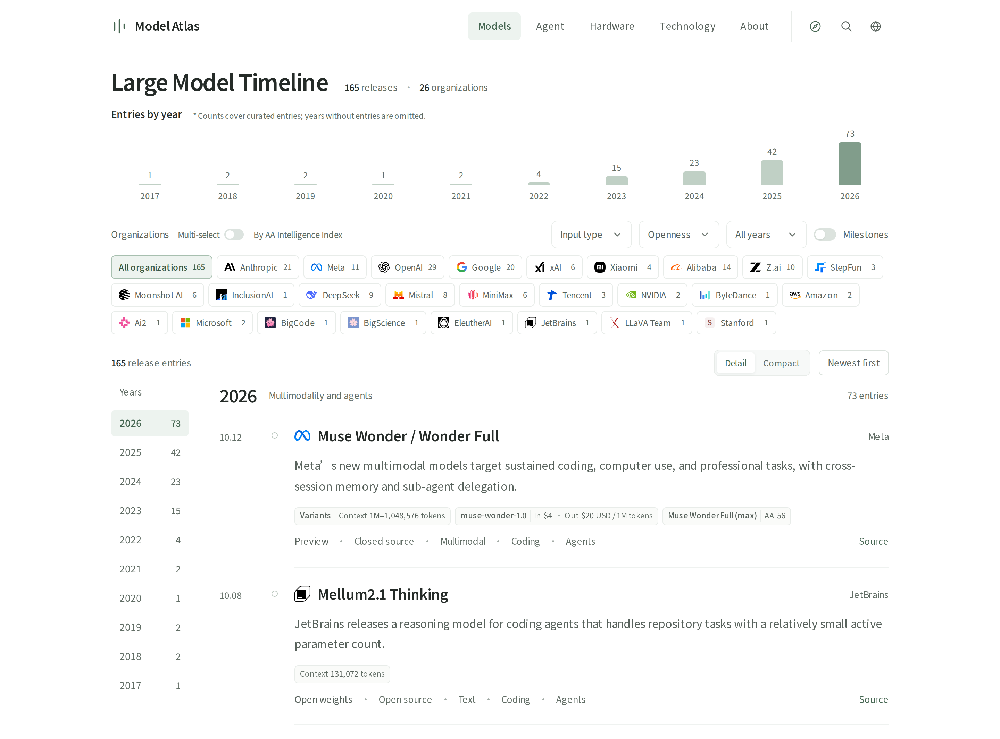
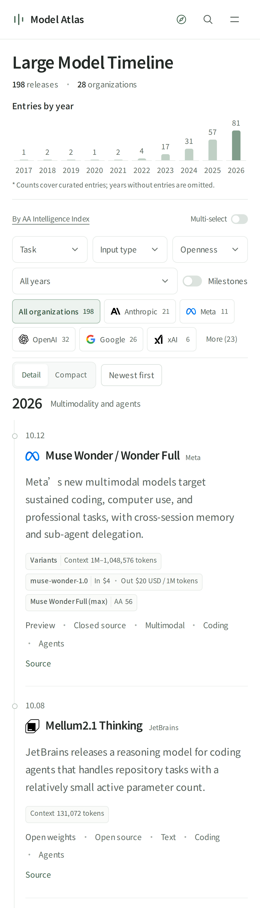
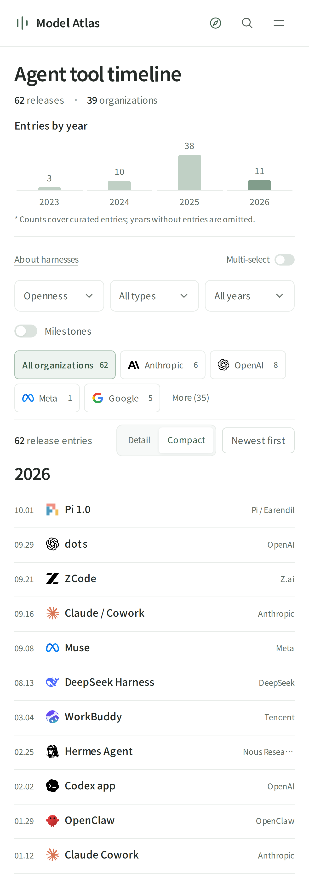
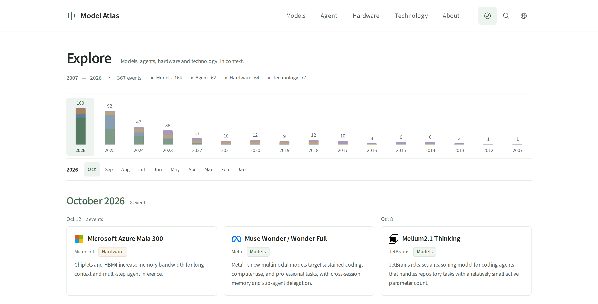

# Model Atlas

A bilingual history of AI models, agents, hardware and key technologies, with verified dates and sources.

English · [简体中文](README.zh-CN.md)

[Live site](https://ai.taifua.com) · [Contributing](#contributing) · [License](#license)



<details>
<summary>Mobile preview</summary>

Left: models in detailed view. Right: agents in compact view.

<p align="center">
  
  
</p>

</details>

<details>
<summary>Explore preview</summary>



</details>

## Four timelines

| Timeline | Coverage |
| --- | --- |
| [Large Model Timeline](https://ai.taifua.com/en/) | Language, multimodal, image and video generation, world simulation, and robot-action model releases, with architecture papers, verified specifications and dated evaluation snapshots. |
| [Agents](https://ai.taifua.com/en/agents.html) | Coding and general-purpose agents, harnesses, frameworks, and protocols. |
| [Hardware](https://ai.taifua.com/en/hardware.html) | GPUs, dedicated accelerators, systems, and local devices, with configuration-specific specifications. |
| [Technology](https://ai.taifua.com/en/technology.html) | Foundational methods, frameworks, inference tools, containers, and sandboxes. |

Entries are selected for historical influence or technical significance. This is a curated reference, with source links and explicit date conventions, rather than an exhaustive release feed.

## Browse

- Search all four timelines and filter by organization, year, task or type. Filters can be shared by URL.
- Read detailed cards or a compact list, newest first. Entries include sources, dates and verified specifications, prices or evaluation snapshots where available.
- Use annual and monthly charts to browse the current selection. Lists load in batches; selecting a year or a filter reveals the matching entries.
- Open [Explore](https://ai.taifua.com/en/explore.html) from the compass icon for a combined chronology, grouped by month and day. [Benchmarks](https://ai.taifua.com/en/benchmarks.html) organizes public evaluations by field, with their methods and comparison limits.
- Browse in Chinese or English on desktop and mobile, with keyboard navigation, reduced-motion support and dedicated language URLs.

The site is static: search, filters and charts run in the browser. Every entry is also included in the generated HTML for reading without JavaScript. Fonts and icons are served locally.

## Privacy

The source and default build include no tracking scripts or analytics service calls. Language and view preferences are stored in the browser. On [ai.taifua.com](https://ai.taifua.com), website analytics is configured separately at deployment and loads only after consent. Declining leaves the site fully usable; the [About page](https://ai.taifua.com/en/about.html#privacy) explains privacy and lets visitors change their choice. Analytics choices are saved for 180 days.

## Run locally

Use **Node.js 22 or 24 LTS**. Previewing, data checks, and builds need no npm dependencies; browser tests use development dependencies.

```bash
git clone https://github.com/taifuer/model-atlas.git
cd model-atlas
npm run dev
```

Open [localhost:5173](http://localhost:5173). To choose an address or port:

```bash
npm run dev -- --host 127.0.0.1 --port 5173
```

Run `npm run dev -- --preview-analytics` to preview the consent prompt and About-page controls. This mode only demonstrates the interaction; it loads no analytics service and sends no analytics data.

## Check and build

```bash
npm run check
npm test
npm run build
```

The build creates `dist/` with seven page types in Chinese and English, a sitemap, and local assets. Deploy that directory to any static host; no Node.js process or backend is needed in production. Asset URLs include content hashes for cache updates. CI runs the same checks on Node.js 22 and 24, plus a separate Chromium browser regression job.

To run browser checks for the first time:

```bash
npm ci
npx playwright install chromium
npm run test:browser
```

The tests build and serve the site locally, covering Chinese/English desktop and mobile flows, detail history, global search, short-screen dialogs, static content, font requests and optional analytics consent. Test dependencies are not included in the published site.

Chinese pages are served from the site root, with English editions under `/en/`. Each static page includes localized titles, descriptions, keywords, canonical and hreflang links, and social metadata. The build also generates `sitemap.xml` and `robots.txt`. For another deployment domain, use `BASE_URL=https://example.com npm run build`. Existing `?lang=en` / `?lang=zh` links remain supported.

## Data and sources

Records are maintained manually. Dates distinguish papers, announcements, previews, releases, and availability. Specifications and prices apply to the named version and configuration; leaderboard results retain their metric, verification date, and available leaderboard date. Missing information stays absent.

The [benchmark directory](https://ai.taifua.com/en/benchmarks.html) covers model and agent evaluations, with their methods and limits of comparison. Hardware references include [MLPerf](https://mlcommons.org/benchmarks/inference-datacenter/). Scores from different benchmarks are kept separate.

The site's “open / closed” filter is an editorial classification of the listed models and tools. It does not describe this repository's license or replace each product's license terms. The [About page](https://ai.taifua.com/about.html?lang=en) explains the conventions.

<details>
<summary>Maintainer tools: source checks and candidate review</summary>

Maintainers can manually check the sources already cited in the catalog:

```bash
npm run check:sources -- --section models --limit 8
npm run check:sources -- --scope price,score --priority high
npm run check:sources -- --scope license,specification --list
npm run check:sources -- --help
```

Reports and normalized content snapshots stay in Git-ignored `research/source-monitor/`, outside the site build. The review queue marks prices, scores, licenses, and specifications as high priority; it preserves entry IDs and links to the original source sections. A changed page is a review candidate, not a confirmed factual update. HTTP 403/429 and network failures are recorded separately from 404/410; none deletes entries or overwrites evidence. HTML comparison omits scripts and most navigation, but dynamic content can still produce differences.

The first run has no accepted baseline. Review the document identity, visible content, and relevant version or configuration before accepting a snapshot. Select reviewed documents by their full source IDs from the report:

```bash
npm run check:sources -- --accept research/source-monitor/reports/<report>.json --source <source-id>,<source-id>
```

Documents from the same report can be accepted in separate review batches. Failed observations cannot be accepted. Unrelated baseline changes require a fresh check; modifying a report after partial acceptance also prevents further acceptance from that report. Omitting `--source` accepts all successful observations in that report, so use it only after reviewing every successful document. Acceptance updates the private comparison baseline, not website data or verification dates. Subsequent runs compare with this baseline. Page changes still need factual review, especially where a live page now describes a different model revision. A normalization-version change is flagged for review rather than silently accepting a new baseline. Oversized pages remain explicit failures; `--max-bytes` can raise the default 4 MiB limit up to 16 MiB for a targeted check.

For release discovery, a separate manual command reads a small registry of official news feeds, public GitHub release feeds, and AA/Arena model lists:

```bash
npm run discover:candidates -- --list
npm run discover:candidates -- --since 2026-10-01
npm run discover:candidates -- --source claude-code,arena-text --limit 10
```

The registry in `scripts/candidate-sources.json` documents each source's coverage. It is a starting set, not a complete release index. `--limit` applies per source. `--since` filters confirmed publication days; entries with unknown dates or only a reported month stay visible for review. A leaderboard appearance or feed modification date is never substituted for a release date.

AA discovery reads both single-model and multi-configuration release cards. When the page declares a visible count, the parser checks it before applying the requested limit; an incomplete list is reported as a parsing failure and leaves prior candidate observations intact.

Reports, raw snapshots, and `queue.json` stay in Git-ignored `research/candidate-discovery/`. Generate a readable private review summary, then record explicit decisions after comparing the sources with the inclusion criteria:

```bash
npm run review:candidates -- --since 2026-10-12
npm run review:candidates -- --source artificial-analysis --status needs_review,deferred
npm run review:candidates -- --from research/candidate-discovery/reviews/<summary>.json --id <full-candidate-id> --decide represented --note "Exact release already covered." --entry models/<entry-id> --evidence https://example.com/release
```

The review command's `--since` means **first observed or content changed**, not released. Summaries include full IDs, source excerpts, publication-date precision, previous reasons, and possible catalog matches. New observations, changed content, and possible matches can overlap. Default status is `needs_review`; `--status all` includes prior decisions. JSON and Markdown summaries stay in the private `reviews/` directory.

Decisions are `represented`, `deferred`, `rejected`, or `needs_review`. Every decision requires a reason; represented entries require an explicit catalog mapping, and represented/rejected decisions require evidence URLs. Generate a fresh summary after each decision batch. Unknown IDs, invalid mappings, concurrent writes, and a queue changed since the summary are refused. Meaningful source changes reopen review, preserve earlier decisions, mappings, and evidence in `reviewHistory`, and retain the date of the change; repeated observations do not create duplicate entries. An observation is a research lead, not a new or approved release. These tools do not import scores, add website entries, schedule checks, or send notifications. Publication still requires editorial review and the normal project checks.

</details>

## Project structure

| Files | Purpose |
| --- | --- |
| `src/` | Website source: seven page templates, frontend JavaScript, CSS, data, and favicon. |
| `src/data*.js` | Bilingual entries, classifications, specifications, prices, and scores. |
| `src/app.js`, `src/filters.js`, `src/site.js`, `src/icons.js`, `src/styles.css` | Rendering, filtering, navigation, language, and layout. |
| `src/assets/` | Local font, icons, and their notices. |
| `scripts/` | Development server, static build, manual source checks, candidate discovery and review, and optional font-subsetting tool. |
| `tests/` | Data and behavior checks, dated score fixtures, and browser regressions in `tests/browser/`. |
| `docs/` | Documentation assets, including desktop and mobile previews. |
| `dist/` | Generated static site, excluded from Git. |

Edit the website in `src/` and run the npm commands from the repository root. The optional font tool is documented in [FONT-NOTICE.md](src/assets/FONT-NOTICE.md). Private research notes, local configuration, and deployment backups are excluded from the repository and build.

## Contributing

Corrections and additions are welcome through issues or pull requests.

- Explain an entry's historical significance, technical representativeness, or demonstrated influence. For hardware, distinguish documented architectural contributions from evidence of adoption for the specific chip or system.
- Provide reliable sources and event dates; match specifications, prices, and scores to the exact version or configuration. Write original summaries rather than copying source pages.
- Update Chinese and English together, preserve stable IDs, and leave unverified information absent.
- Run `npm run check`, `npm test`, and `npm run build`; check mobile and desktop layouts when changing the interface.

## License

Original code and original editorial text are available under the [MIT License](LICENSE). Noto Sans SC uses [SIL Open Font License 1.1](src/assets/OFL.txt); see the [font notice](src/assets/FONT-NOTICE.md). Icon sources and their recorded licenses are listed in the [icon notices](src/assets/icons/NOTICE.md).

External data, evaluation material, and brand marks are not relicensed under MIT; their respective rights and terms still apply. The project is independent of the organizations it documents.

Arena score snapshots derived from its [official dataset](https://huggingface.co/datasets/lmarena-ai/leaderboard-dataset) use CC BY 4.0; displayed ratings and confidence intervals are rounded and retain source dates.
